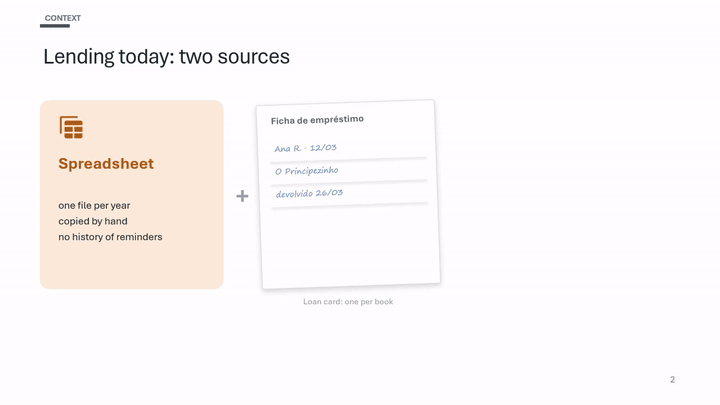
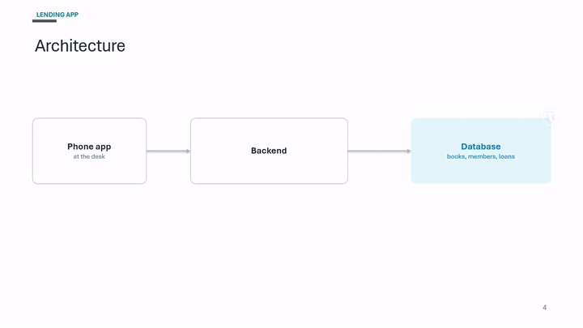
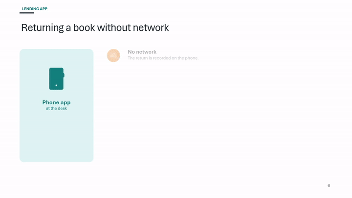
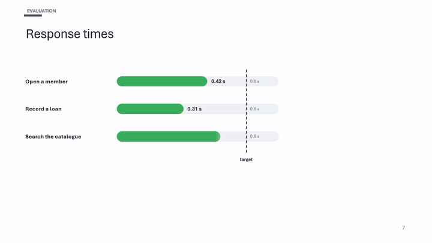

# morph-deck

Build PowerPoint decks as code — by hand or with an AI agent — on **any template**, with **colour that means
something** and **Morph transitions that carry shapes from one slide to the next**.

| Sources become the contributions they led to | A component zooms into its own slide |
|---|---|
|  |  |
| **A dot carries each step along the timeline** | **The limit line turns into the next chart's limit** |
|  |  |

All four are from [`examples/demo`](examples/demo/build.py), a nine-slide fictional deck.

## Why

Slide tools make it easy to add effects and hard to make them mean anything. morph-deck is the opposite: a small
library plus a set of rules, extracted from a thesis defence that had to explain a database-heavy system to a
jury in twenty minutes.

- **Semantic colour.** Status colours (bad / good / fail) for judgements, one identity colour per thread of the
  talk, neutral everything else. Declared once, checked by name.
- **Morph links.** A shape named `!!api` on slide 4 and `!!api` on slide 5 is the same thing: PowerPoint moves
  and resizes it. The rules for making that reliable are in [AGENTS.md](AGENTS.md).
- **A linter for the mistakes that break Morph decks**: a Morph target with an entrance animation, a shape
  visible before its click, a motion path that snaps back, duplicated links, fonts inherited from the template.
- **Render and video from the command line**, so an agent can look at its own work frame by frame.

## Use it with an AI agent

The workflow and rules live in [`AGENTS.md`](AGENTS.md), plain Markdown any agent can read:

- **Codex, Cursor, Copilot, Gemini CLI, Aider, …** — copy `AGENTS.md` into your deck's project (or point your
  agent at it), then ask for the deck.
- **Claude Code** — copy [`skill/`](skill) to `~/.claude/skills/morph-deck/`; it's the same text with skill
  metadata, generated from `AGENTS.md`.

The agent then works in steps: skeleton → content → colour pass → link pass → animation → lint, render and look
at the frames.

## Install

```bash
pip install "morphdeck[logos] @ git+https://github.com/JoaoCodificacoes/morph-deck"
```

Python 3.11+. The `logos` extra (cairosvg) is only needed for technology logos.

## Quick start

```bash
morphdeck inspect my-template.pptx -o deck.toml    # find layouts, placeholders, fonts; check the guesses
```

```python
from morphdeck import Deck, box, label, line, animate, stage

deck = Deck("deck.toml")
P = deck.palette

s = deck.slide("content", "Architecture")
api = box(s, 4.3, 2.7, 3.6, 1.5, fill=P.white, line=P.edge, name="!!api")
label(api, "Backend", bold=True)
db = box(s, 9.4, 2.7, 3.2, 1.5, name="!!db")
arrow = line(s, 7.9, 3.45, 9.4, 3.45, arrow=True)
animate(s, [[stage([arrow], "wipe-right", 350), stage([db], delay=-100)]])

s = deck.slide("content", "Every request is checked")                 # enters with Morph
box(s, 4.0, 1.85, 4.3, 4.3, fill=P.white, line=P.edge, name="!!api")   # the backend widens
box(s, 9.4, 2.7, 3.2, 1.5, name="!!db")                                # the database stays

deck.save("out/deck.pptx")      # saves and lints
```

Then look at it:

```bash
morphdeck render out/deck.pptx out/png
morphdeck video out/deck.pptx --slides 1,2 -o out/t.mp4 && morphdeck sheet out/t.mp4 -o out/t.png
```

## Command line

| Command | Does |
|---|---|
| `morphdeck inspect template.pptx [-o cfg.toml]` | list layouts, placeholders and theme fonts; write a starter config |
| `morphdeck lint deck.pptx [-v]` | check Morph links and animations; non-zero exit on errors |
| `morphdeck render deck.pptx out/` | slide PNGs |
| `morphdeck video deck.pptx --slides 3,4 -o v.mp4` | record slides with clicks auto-advancing |
| `morphdeck sheet v.mp4 -o sheet.png` | contact sheet of frames |
| `morphdeck gif v.mp4 -o clip.gif --start 2 --end 5` | a short GIF |

## Limitations

- **Morph and the animations play only in PowerPoint** (Windows, Mac, web). Other viewers show the slides
  with a fade.
- **Building works anywhere; `render` and `video` need PowerPoint on Windows**, or WSL with PowerPoint installed
  on the Windows side. They drive PowerPoint through COM. `lint`, `inspect`, `sheet` and `gif` work anywhere
  (`sheet`/`gif` need ffmpeg).
- Video export can't run while the same file is open for editing in PowerPoint.

## Layout of the repo

```
AGENTS.md              the rules and workflow (canonical)
skill/SKILL.md         the same, as a Claude Code skill (generated: python scripts/build_skill.py)
morphdeck/             the library: template, draw, icons, palette, motion, morph, lint, cli
templates/neutral/     a plain 16:9 template, its config, and the script that makes it
examples/demo/         the demo deck
tests/                 pytest; lint rules are tested on decks that break them
```

## Credits

Icons: [Material Symbols](https://fonts.google.com/icons) by Google (Apache 2.0), downloaded on first use.
Logos: [Simple Icons](https://simpleicons.org) (CC0); the logos are trademarks of their owners.
See [NOTICE](NOTICE). Code under the [MIT licence](LICENSE).
